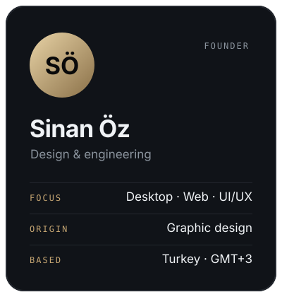
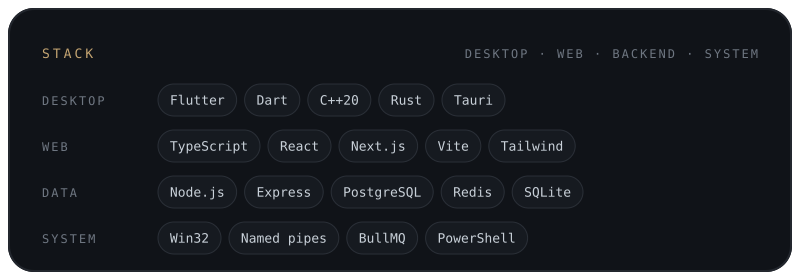
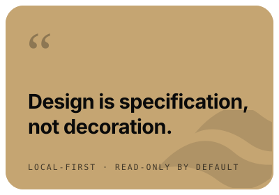
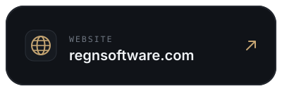
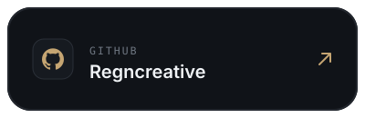
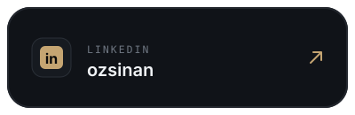

<!-- Generated by scripts/build-readme.mjs — edit the generator, not this file. -->

&nbsp;&nbsp;

<a href="https://pulse.regncreative.com">pulse.regncreative.com</a> &nbsp;·&nbsp; <a href="https://wedge.regncreative.com">wedge.regncreative.com</a> &nbsp;·&nbsp; <a href="https://fiyatavcisi.com">fiyatavcisi.com</a> &nbsp;·&nbsp; 

